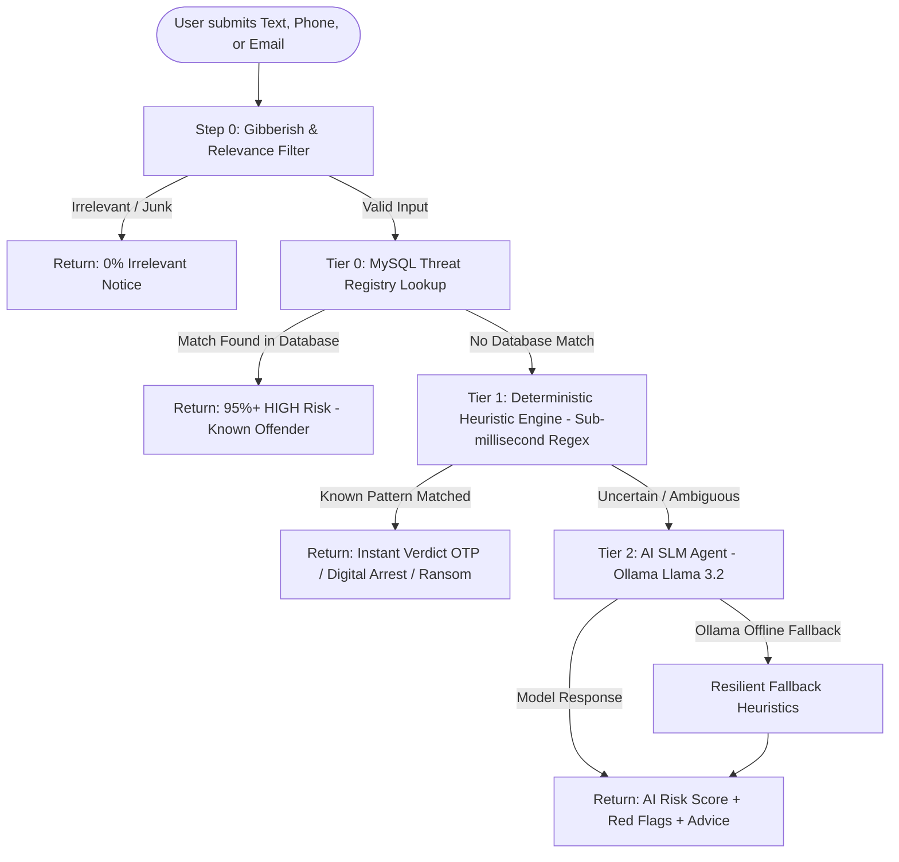

# 🛡️ ScamShield AI — Multi-Vector Cyber Fraud Intelligence Platform

<p align="center">
  
  
  
  
</p>

> **ScamShield AI** is an advanced cyber fraud intelligence and real-time threat detection system engineered to protect citizens from financial scams, phishing attacks, impersonation extortion, and digital coercion. Built with a hybrid multi-tier detection pipeline combining sub-millisecond deterministic heuristics with local Small Language Models (SLMs).

---

## ⚡ Key Highlights

- **Multi-Vector Threat Diagnostics:** Evaluates 3 distinct attack vectors:
  - 📩 **SMS & Text Smishing:** OTP solicitation, digital arrest extortion, task scams, and fake courier messages.
  - 📞 **Phone Number Verification:** International VoIP corridor analysis, premium-rate shortcodes, and carrier telemetry.
  - 📧 **Advanced Email Phishing:** Header SPF validation, malicious attachment scanning (`.exe`, `.scr`, `.bat`), and domain spoofing.
- **3-Tier Hybrid Defense Pipeline:**
  - **Tier 0:** High-speed MySQL database threat registry lookup (`phone_threat_records`, `email_threat_records`).
  - **Tier 1:** Sub-millisecond deterministic regex heuristics for known extortion signatures.
  - **Tier 2:** Local AI SLM (`llama3.2` agent via Ollama) with resilient fallback heuristics.
- **Real-Time SOC Dashboard:** Live security operations center tracking threats, vector distributions, database health, and telemetry.
- **Geospatial Hotspot Radar:** India-wide cyber fraud mapping tracking syndicates across major hubs.
- **Crowdsourced Intelligence & Auto-Ingestion:** Automatically parses and indexes reported phone numbers and emails into MySQL threat tables upon report submission.
- **Police Cyber Cell PDF Generator:** One-click generation of official incident dossiers ready for submission to `cybercrime.gov.in` or helpline **1930**.

---

## 🏗️ System Architecture



---

## 🛠️ Technology Stack

| Layer | Technologies |
| :--- | :--- |
| **Frontend** | React 18, Vite 6, TailwindCSS (Cyber Neon & Obsidian Void), React Router 6, Lucide React, jsPDF |
| **Backend** | Node.js, Express.js, `mysql2/promise`, `cors`, `express-rate-limit`, `node-fetch` |
| **Database** | MySQL (`cyber_fraud_db` with `phone_threat_records` and `email_threat_records`) |
| **AI / SLM Engine** | Ollama, Llama 3.2 (Custom `Modelfile` with strict JSON schema enforcement) |

---

## 🚀 Getting Started

### Prerequisites
- Node.js (v18+) & npm
- MySQL Server (optional, built-in resilient fallback)
- Ollama (optional, for local neural SLM evaluation)

### 1. Clone the Repository
```bash
git clone https://github.com/Kabba01022006/ScamShieldAI.git
cd ScamShieldAI
```

### 2. Install Dependencies
```bash
# Install frontend dependencies
npm install

# Install backend dependencies
cd server
npm install
cd ..
```

### 3. Setup AI Model (Optional)
If running Ollama locally:
```bash
ollama create scamshield-agent -f Modelfile
ollama serve
```

### 4. Run the Application
In separate terminal windows:

```bash
# Start Backend Engine (Port 5001)
cd server
node index.js

# Start Frontend UI (Port 5173)
npm run dev
```

Visit **http://localhost:5173** to access the platform.

---

## 🔒 Privacy & Zero-Knowledge Architecture

ScamShield AI utilizes **local Small Language Models** (SLMs) and client-side processing to ensure that sensitive user messages, phone logs, and financial records never leak to third-party cloud providers.

---

## 📜 License
This project is licensed under the MIT License.
